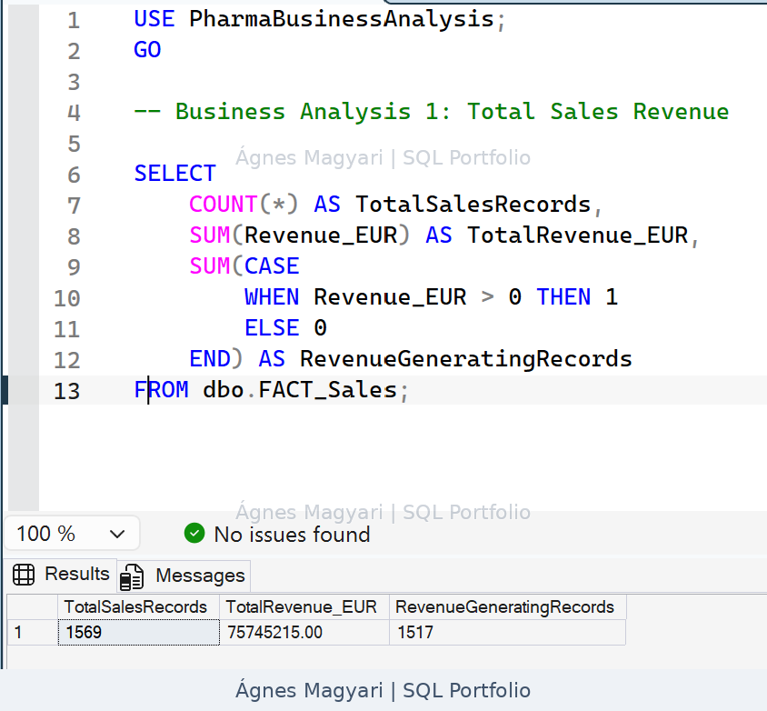
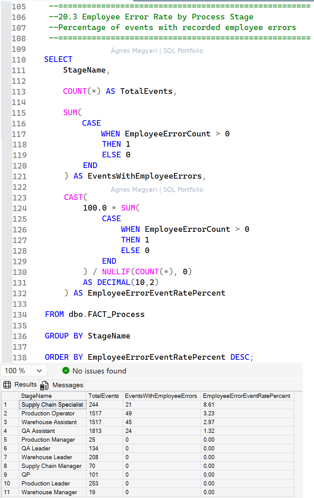

# Pharma Business Analysis | SQL Server & Power BI

### From SQL Analysis to Business Decisions

**Executive Portfolio Project | Simulated Pharmaceutical Business | 2024–2025**  
*SQL-Centered Business Analysis with Executive Power BI Reporting*

> **Portfolio scope:** This is a historical, descriptive analysis of fictional business data. SQL Server investigation and Excel-sourced Power BI reporting were performed in separate environments; no direct SQL Server–Power BI connection or automated pipeline is claimed.

## Executive Summary

This self-directed portfolio project translates commercial and operational business questions into structured SQL investigation, validated performance indicators, and management-oriented reporting. The analysis covers simulated pharmaceutical business records for 2024–2025, with financial reconciliation in Excel and a complementary Power BI executive dashboard.

| Executive KPI | Validated result |
|---|---:|
| Total Revenue (2024–2025) | €75,745,215 |
| Revenue Growth (2025 vs. 2024) | +12.76% |
| Recorded Profit Margin | 33.68% |
| Process Issue Rate | 24.72% |
| Employee Error Event Rate | 2.36% |

**Three management takeaways:** Revenue increased year over year, but product-level work is needed to explain its drivers. Issue-coded events warrant further operational review, without assuming severity or root causes. Twelve classification observations warrant clarification of recording rules, not automatic source-data correction.

## Business Context & Analytical Objectives

Management needs a consistent view of commercial performance, operational event monitoring, and reporting reliability. The project addresses three questions: How did revenue and recorded profitability develop? How frequently were process events assigned issue codes or employee-error indicators? How consistently can the available records support KPI interpretation?

The objectives were to establish and reconcile financial and operational indicators, assess performance patterns, document classification observations, and translate validated findings into targeted management follow-up questions. The work does **not** claim causal findings, implemented interventions, or realized business improvements.

## Data Architecture & Analytical Methodology

| Environment | Purpose and demonstrated scope |
|---|---|
| **SQL Server / SSMS** | Dedicated analytical database; 20 structured tasks covering preparation, filtering, conditional logic, aggregation, business investigation, and quality checks |
| **Microsoft Excel** | Financial reconciliation of sales records and preparation of the reporting dataset |
| **Power BI / DAX** | Seven-page Excel-based report, including an SQL Executive Overview with five KPI cards and four visuals |

**Workflow:** Business questions → SQL investigation → KPI validation and data-quality review → Excel-based executive reporting.

The SQL and Power BI environments were distinct. Power BI did **not** connect directly to SQL Server. The reported measures are interpreted within the definitions and limits of the simulated source data.

### Financial reconciliation

The defined calculation was:

`Calculated Profit = Revenue − Purchase Cost − Inventory Holding Cost`

Across **1,569 sales records**, calculated profit reconciled to recorded profit with **€0.00 difference for every examined record** under this methodology. This confirms internal calculation consistency; it is **not** an independent financial audit and does not establish an audited corporate net profit margin.

## Key Business Findings & KPI Validation

### Commercial performance

| Indicator | Result |
|---|---:|
| Revenue, 2024 | €35,600,900 |
| Revenue, 2025 | €40,144,315 |
| Absolute increase | €4,543,415 |
| Year-over-year revenue growth | +12.76% |
| Total revenue, 2024–2025 | €75,745,215 |
| Recorded profit margin | 33.68% |

Revenue increased by €4.54 million in 2025. The **33.68% recorded profit margin** reflects the dataset's defined cost structure, rather than an audited corporate net profit measure. Aggregate growth does not identify its causes or the products responsible; product-level revenue contributions and margin variation remain priorities for investigation.

### Operational quality and event monitoring

| Indicator | Count | Share of 5,901 events |
|---|---:|---:|
| Total recorded process events | 5,901 | 100.00% |
| Issue-coded events | 1,459 | 24.72% |
| Events without an issue code | 4,442 | 75.28% |
| Employee-error events | 139 | 2.36% |
| Events without a recorded employee error | 5,762 | 97.64% |

**Classification definitions:**

- **Issue-coded event:** `IssueCode` is neither `NONE` nor blank.
- **Employee-error event:** `EmployeeErrorCount > 0`.

These are **distinct, potentially overlapping event classifications**. The employee-error event rate counts affected events, **not** the total number of individual errors or employees. Neither rate establishes issue severity, causes, financial impact, or individual employee performance.

## Data Quality & Analytical Integrity

A focused SQL investigation identified **12 QA Assistant events** where `EmployeeErrorCount > 0` while `IssueCode = NONE`—approximately **0.20% of all 5,901 process events**.

This is a **classification observation, not a confirmed data error**. The fields may capture different business concepts or follow different recording rules. All 12 source records were preserved without correction or reclassification.

A responsible follow-up would confirm field definitions with process owners, review event-recording rules, examine the observations, and document any justified validation controls. No rule violation, causal explanation, operational impact, or individual performance conclusion is established by the available evidence.

## Business Recommendations & Decision Support

| Management priority | Evidence | Recommended review | Potential decision value |
|---|---|---|---|
| **Commercial performance & portfolio** | €75.75M revenue; +12.76% growth; 33.68% recorded margin | Examine product-level growth contributions, profitability variation, and revenue concentration | Better-informed portfolio and resource-allocation discussions |
| **Operational quality** | 1,459 issue-coded events; 139 employee-error events | Review issue categories, recurring patterns, severity, and potential business impact | More targeted operational investigation and monitoring |
| **Data governance** | 12 QA Assistant classification observations | Confirm field definitions, recording rules, and permissible classifications | More consistent and interpretable operational KPIs |

**Executive recommendation:** Prioritize investigation of commercial growth drivers and operational issue patterns while clarifying event-classification rules. Specific interventions should follow additional evidence and confirmed business requirements. These are proposed reviews, **not** actions already implemented.

## Technical & Analytical Competencies Demonstrated

### SQL Server / SSMS — Applied Business Analysis

**SQL was used to investigate business questions, calculate and validate KPIs, and examine event-classification consistency across 20 structured analytical tasks.**

Selected examples include:

| Business question | SQL work performed | Analytical value |
| --- | --- | --- |
| How did revenue change between 2024 and 2025? | Aggregated revenue by year and calculated the absolute change and year-over-year growth rate | Established €4.54M revenue growth, equivalent to 12.76% |
| How frequently were process issues recorded? | Applied issue-code classification rules and aggregated event counts against the total of 5,901 process events | Validated 1,459 issue-coded events and the 24.72% Process Issue Rate |
| How frequently were employee errors recorded at event level? | Identified events where `EmployeeErrorCount > 0` and calculated their share of all process events | Validated 139 affected events and the 2.36% Employee Error Event Rate |
| Were employee-error indicators consistently accompanied by issue codes? | Combined conditions on role, employee-error count, and issue code to isolate records for review | Identified 12 QA Assistant classification observations, preserved without unsupported correction |

**SQL capabilities applied:** data preparation, filtering, conditional logic, aggregation, percentage calculations, and targeted data-quality investigation.

### Validation, Reporting & Decision Support

- **Financial reconciliation:** Reconciled calculated and recorded profit across 1,569 sales records in Excel, with €0.00 difference for every examined record.
- **Power BI / DAX:** Developed a seven-page Excel-sourced report, including an executive overview with five KPI cards and four visuals.
- **Business interpretation:** Distinguished event rates from individual error counts and documented the limits of the available evidence.
- **Decision support:** Translated validated findings into management review priorities covering commercial performance, operational quality, and data governance.

## Selected SQL Analysis Screenshots

Two selected SSMS screenshots illustrate the SQL work behind the portfolio findings. All business data shown is simulated.

### Total Sales Revenue

Record counting, revenue aggregation, and conditional aggregation identify 1,569 sales records, €75,745,215 in total revenue, and 1,517 records with positive revenue.

### Employee Error Event Rate by Process Stage

Grouping and conditional aggregation calculate the share of events with recorded employee errors within each process stage. The query includes decimal percentage calculations, division-by-zero protection, and descending sorting.

These rates describe recorded events and do not establish individual employee performance or the causes or severity of errors.

## Executive Dashboard Showcase

The approved **SQL Executive Overview | Power BI** presents five executive KPIs alongside four business visuals: **Revenue Trend**, **Revenue by Product**, **Process Events by Issue Status**, and **Employee Error Events**.

The dashboard summarizes recorded commercial performance and event-level operational indicators. Product revenue concentration and event classifications invite investigation; the charts do not establish causality or issue severity. **The dashboard uses an Excel-based reporting dataset, not a direct SQL Server connection.**

## Project Ownership, AI Assistance & Rights

This self-directed portfolio initiative was guided by the project owner, who defined the business concept, industry context, analytical objectives, priorities, interpretation, iterative review, and presentation direction.

**AI-assisted development** provided technical support for SQL, Power BI and DAX, validation procedures, methodological explanations, and report drafting. This attribution does not claim independent completion of every technical implementation step or measurable results for a real pharmaceutical business.

**Rights notice:** © 2026 Project Owner, to the extent applicable to original human-authored material. Rights in third-party materials remain with their respective owners. No exclusive copyright is claimed over AI-generated content solely because it appears in this portfolio. No permission to reuse the project owner's independently protected original materials is granted by this notice, except as permitted by applicable law or separately authorized.

## Publication Scope & Professional Discussion

The intended public repository contains this executive report, validated business findings, methodology, a **watermarked** executive dashboard image, and two selected **watermarked SQL screenshots** showing query examples and their results. Full SQL scripts, DAX source code, PBIX files, original Excel datasets, development files, and detailed technical documentation remain private. Supporting technical work may be discussed or demonstrated during a professional interview at the project owner's discretion.

*All business data is simulated. Findings are descriptive and do not represent actual pharmaceutical business performance.*
